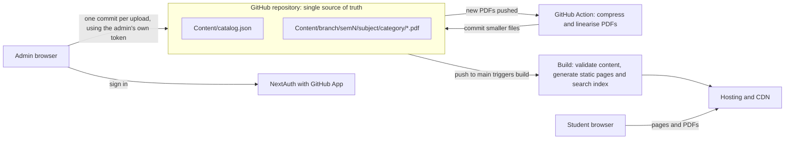
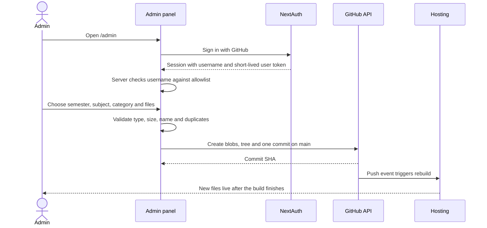

# pyq — NIT Patna Question Papers and Study Material

A single, well-organised place where NIT Patna students can find previous-year question papers (PYQs) and study material, arranged by branch, semester and subject. All content lives in this repository; the website reads it from here.

> **Document status:** Draft v0.6 · 12 October 2026 · Owner: Harsh
>
> This README contains the Product Requirements Document (Part A) and the Software Requirements Specification (Part B). No application code will be written until this document has been reviewed and the open questions in [§A10](#a10-open-questions) have been answered.

## Contents

- [Part A — Product Requirements Document](#part-a--product-requirements-document)
- [Part B — Software Requirements Specification](#part-b--software-requirements-specification)
- [Part C — Development workflow and project rules](#part-c--development-workflow-and-project-rules)
- [Part D — Running the project](#part-d--running-the-project)
- [Change log](#change-log)
- [Licence](#licence)

---

# Part A — Product Requirements Document

## A1. Problem statement

Without a central source, question papers and notes circulate informally through messaging groups and personal drive folders. As a result:

- files are scattered and are lost when messages expire or groups are archived;
- there is no consistent naming, so the same paper appears several times under different names while other years are missing altogether;
- finding the right paper shortly before an examination takes too long, particularly on a phone with limited bandwidth.

## A2. Goals and non-goals

**Goals**

| ID | Goal |
|----|------|
| G1 | Any student can reach a specific paper in three clicks or fewer from the home page, without signing in. |
| G2 | All content is organised consistently (branch → semester → subject → category) and named by a fixed convention. |
| G3 | Only authorised admins can add, replace or remove content, through a guided admin panel. |
| G4 | The repository is the single source of truth. There is no separate database to operate or pay for. |
| G5 | The site is fast on low-end phones and slow mobile connections. |

**Non-goals for version 1**

- Student accounts, profiles or synced bookmarks.
- Direct uploads by students (a reviewed contribution flow is a P2 item).
- Comments, discussions, solutions or ratings.
- Hosting copyrighted textbooks or paid material.
- Native mobile applications.

## A2.1 Point of view: "Handed down"

pyq is what seniors pass to juniors the night before an exam: *the paper before the paper*. Its identity comes from exam-hall details and true counts, not from generic marketing copy.

- **Voice:** a kind, dry senior. Plain English, no slang or in-jokes, never official-sounding (the site is unofficial).
- **Vocabulary:** sharing a paper is *handing it down*; a missing paper is *left blank*; the 404 page is *out of syllabus*.
- **Honesty:** the site never claims coverage it does not have. Every count is computed from the files at build time, and empty subjects say so.
- **One accent:** ballpoint blue ink (`#2340C4` light, `#8EA2FF` dark) on the monochrome hero theme, used for filled bubbles, focus rings and the horizon.

This direction came from a design council; the full record is in [docs/design-council.md](docs/design-council.md).

## A3. Users

| Persona | Description | Primary needs |
|---------|-------------|---------------|
| Student | B.Tech student at NIT Patna, mostly on a phone, often searching close to an examination. | Find the right paper quickly; preview before downloading; work well on slow networks. |
| Admin | Trusted maintainer (for example a club member or class representative) whose GitHub account the owner has approved. | Upload correctly named files quickly; correct mistakes safely; never break the site. |
| Owner | Repository owner. | Control who is an admin; review all code changes; keep the repository healthy. |

## A4. User stories

| ID | As a… | I want to… | So that… | Requirements |
|----|-------|------------|----------|--------------|
| US-01 | student | choose my semester from the home page | I see only the subjects relevant to me | FR-S-01, FR-S-02, FR-S-03 |
| US-02 | student | see every PYQ for a subject, newest first, grouped by examination | I can practise year by year | FR-S-04 |
| US-03 | student | preview a paper before downloading it | I do not waste data on the wrong file | FR-S-05 |
| US-04 | student | search by subject name, subject code or year | I can go straight to what I need | FR-S-06 |
| US-05 | student | share a link to a subject page | classmates land on exactly the same page | FR-S-07 |
| US-06 | admin | upload a paper by choosing semester, subject, year and examination from lists | the file is named and placed correctly without typing paths | FR-A-02, FR-A-03, FR-A-04 |
| US-07 | admin | upload several files in one submission | I can add a whole year's papers quickly | FR-A-04 |
| US-08 | admin | replace or delete a wrong file, with a confirmation step | mistakes can be fixed but never happen by accident | FR-A-07, FR-A-08 |
| US-09 | admin | add a subject to a semester | new courses appear for students | FR-A-06 |
| US-10 | owner | decide exactly who is an admin | nobody else can change content | FR-A-01, NFR-SEC-01 |

## A5. Scope and priorities

P0 = required for launch · P1 = shortly after launch · P2 = later.

| Area | Feature | Priority |
|------|---------|----------|
| Student portal | Branch → semester → subject → category browsing | P0 |
| Student portal | PYQs grouped by year and examination | P0 |
| Student portal | Preview in the browser's PDF viewer, and download | P0 |
| Student portal | Lazy loading: no PDF is fetched until a student opens it | P0 |
| Content pipeline | Automatic PDF compression and fast-web-view optimisation after every upload | P0 |
| Student portal | Site-wide search (client-side, no server) | P0 |
| Student portal | Light and dark theme following the device setting | P0 |
| Student portal | Filters on the subject page (category, year, examination) | P1 |
| Student portal | Search-engine optimisation: page titles, descriptions, sitemap | P1 |
| Student portal | "Recently added" list on the home page | P2 |
| Student portal | "Report a problem or request a paper" link | P2 |
| Admin panel | GitHub sign-in restricted to an allowlist | P0 |
| Admin panel | Guided upload, single or batch, as one commit | P0 |
| Admin panel | Validation of type, size, name and duplicates | P0 |
| Admin panel | Replace and delete with confirmation | P0 |
| Admin panel | Subject (catalog) management | P0 |
| Admin panel | Activity log of recent content changes | P1 |
| Admin panel | Review queue for student-submitted material | P2 |

## A6. Information architecture

```
/                                   Home: choose branch (if more than one) and semester
/[branch]/sem[n]                   Semester: list of subjects
/[branch]/sem[n]/[subject]         Subject: materials grouped by category
/admin                              Admin page (sign-in required): upload, uploaded files, subjects
/Content/...                        The PDF files themselves
```

Search is available from every page. The branch segment is present in URLs even if only one branch is launched, so that adding branches later does not break existing links.

## A7. Success metrics

| Metric | Target | How it is measured |
|--------|--------|--------------------|
| Clicks from home page to a specific paper | ≤ 3 | Design review and usability test with five students |
| Time for a first-time student to find a named paper | ≤ 30 seconds | Usability test |
| PYQ coverage at launch | ≥ 80 % of current-semester subjects of the launch branch have at least one PYQ | Generated content index |
| Admin time to upload one paper | ≤ 1 minute | Timed admin test |
| Broken links on the site | 0 | Content validation in CI |
| Mobile Lighthouse performance score | ≥ 90 | Lighthouse on the subject page |
| Monthly unique visitors | Baseline in the first month, then tracked | Hosting analytics |

## A8. Release plan

| Milestone | Deliverable | Exit criteria |
|-----------|-------------|---------------|
| M0 | This PRD and SRS | Reviewed by the owner; open questions answered |
| M1 | Project scaffold, content model, validation script, sample content | Build generates the content index from sample content; CI validation passes |
| M2 | Student portal | All P0 student requirements met on mobile and desktop |
| M3 | Admin panel | All P0 admin requirements met; access tested with a non-admin GitHub account |
| M4 | Launch | Site deployed; launch-branch content seeded; accessibility and performance checks pass |
| M5 | P1 features | Each P1 requirement meets its acceptance criteria |

## A9. Risks

| Risk | Impact | Mitigation |
|------|--------|------------|
| Repository grows too large because of scanned PDFs | Slow clones and builds; GitHub size guidance exceeded | 6 MB per-file limit; automatic compression (FR-B-05); move files to object storage when the repository approaches 1 GB (NFR-SCALE-01). Because compression runs after the upload commit, the original file (at most 6 MB) also remains in Git history. |
| Copyright or takedown request | Content must be removed promptly | Publish only material the project is permitted to share; takedown contact in the site footer; removal through FR-A-08 |
| Admin uploads a wrong or mislabelled file | Students study the wrong paper | Target-path preview, validation, replace and delete, full Git history |
| Admin account is compromised | Unwanted changes to the repository | Small allowlist; GitHub two-factor authentication required for admins; every change is a revertible commit |
| Hosting free-tier limits (bandwidth, build minutes, deployment size) | Site slow or unavailable | Fully static student site; monitor usage; the site can move to another static host without code changes to content |

## A10. Open questions

| # | Question | Assumption used until answered |
|---|----------|--------------------------------|
| Q1 | Launch with CSE only, or with all B.Tech branches? | CSE only; the content model supports all branches. |
| Q2 | ~~Who are the admins?~~ **Answered (v0.2):** every person whose GitHub profile URL is listed in the `ADMIN_GITHUB_PROFILES` environment variable. | — |
| Q3 | Which hosting platform? | Vercel (suits Next.js; free tier; rebuilds on every push). |
| Q4 | Should the site be public, or restricted to institute email accounts? | Public, with no sign-in for students. |
| Q5 | Are file types other than PDF needed (for example PPTX or images)? | PDF only. |
| Q6 | ~~What is the subject list for each semester?~~ **Answered (v0.4):** taken from the subject folders under `Content/CSE/`. Display names and codes can be corrected on the admin page. | — |
| Q7 | Is a custom domain required at launch? | The host's default domain. |
| Q8 | Who handles takedown requests, and through which contact? | The owner, through a contact link in the footer. |

---

# Part B — Software Requirements Specification

This specification loosely follows the structure of ISO/IEC/IEEE 29148 (formerly IEEE 830).

## B1. Introduction

### B1.1 Purpose

This SRS specifies the functional and non-functional requirements of the pyq website: a public student portal and a restricted admin panel, both backed by the `Content/` folder of this repository. It is the reference for implementation, review and testing.

### B1.2 Scope

In scope: the student portal, the admin panel, the content model and its validation, and the build and deployment pipeline. Out of scope: the non-goals listed in [§A2](#a2-goals-and-non-goals).

### B1.3 Definitions

| Term | Meaning |
|------|---------|
| PYQ | Previous-year question paper. |
| Material | Any file published on the site: PYQ, notes, slides, assignment, lab manual or syllabus. |
| Catalog | `Content/catalog.json`, the list of branches and subjects. |
| Content index | JSON file generated at build time that lists every valid material. |
| Admin | A GitHub user on the allowlist who may change content through the admin panel. |
| Owner | The repository owner, who manages the allowlist and reviews code. |

### B1.4 References

- ISO/IEC/IEEE 29148:2018, Requirements engineering.
- Web Content Accessibility Guidelines (WCAG) 2.1.
- GitHub REST API documentation (Git Database and Commits endpoints).

## B2. Overall description

### B2.1 Product perspective

The product is a self-contained web application with no database. The Git repository is the data store: every material is a file under `Content/`, and every change is a commit. The website is regenerated automatically whenever `main` changes, and PDF files are published as static files alongside the generated pages.



Upload sequence:



### B2.2 Product functions

- Browse materials by branch, semester, subject and category.
- Preview and download PDF files.
- Search across subjects and materials.
- Sign in as an admin; upload, replace and delete materials; manage subjects.
- Validate content at upload time, at build time and in CI.

### B2.3 User classes

| Class | Access |
|-------|--------|
| Student | Anonymous, read-only. |
| Admin | Signed in with GitHub and on the allowlist; may write under `Content/` through the panel. |
| Owner | Repository administrator; manages the allowlist in the host's environment settings and reviews all code changes. |

### B2.4 Operating environment

- Browsers: the two most recent versions of Chrome, Edge, Firefox and Safari; Chrome on Android; Safari on iOS.
- Minimum viewport width: 360 px.
- Build: Node.js LTS on a host that supports Next.js.

### B2.5 Technology stack (proposed)

| Layer | Choice | Reason |
|-------|--------|--------|
| Framework | Next.js (App Router) with TypeScript | Static generation for student pages, server routes for admin authentication |
| Styling | Tailwind CSS 4 with the shadcn/ui structure (`components/ui`, `components.json`), Geist and lucide icons | No runtime cost; consistent design tokens; new shadcn components drop straight in |
| Authentication | NextAuth.js (v4, the stable release) using a GitHub App as the provider | Admin identity is the GitHub identity; tokens are limited to this repository |
| GitHub access | GitHub REST API through `fetch` | A handful of calls does not justify an SDK |
| Search | Client-side filtering of the generated JSON index | No search service required; the index is small |
| PDF optimisation | Ghostscript and qpdf in a GitHub Actions workflow | Free, well-proven command-line tools; runs off the user's path |
| Hosting | Vercel by default (see Q3) | Rebuilds on every push to `main`; free tier |
| Data store | This repository | No database to run or pay for |

Deliberately not used in version 1: a database, a headless CMS, a hosted search service and an animation library. None is needed to meet the requirements below.

### B2.6 Design and implementation constraints

| ID | Constraint |
|----|------------|
| C1 | The repository is the only data store. Student pages shall not call the GitHub API at request time (rate limits and availability). |
| C2 | GitHub rejects files larger than 100 MB and recommends keeping repositories small. To keep the repository small and the site fast, each material is limited to **6 MB**. |
| C3 | Serverless request bodies on common hosts are capped at a few megabytes (4.5 MB on Vercel). File contents therefore shall not pass through the application's server routes; uploads go from the admin's browser directly to the GitHub API. |
| C4 | Under `Content/`, the branch folder is its code (for example `CSE`) and semester folders are `sem1` to `sem8`. Subject folders and file names are lowercase ASCII in kebab-case, with no spaces. |
| C5 | Only material the project is permitted to share may be published. Copyrighted textbooks are excluded. |

### B2.7 Assumptions and dependencies

- B.Tech programmes have eight semesters. Other programmes are out of scope for version 1.
- The repository is public, so all published material is publicly downloadable (consistent with Q4).
- Every admin has a GitHub account with two-factor authentication enabled.
- The site depends on the availability of GitHub (for admin writes and builds) and of the hosting platform (for serving).

## B3. Content model

### B3.1 Repository layout

This follows the folders already set up in the repository (`Content/CSE/sem1` to `sem7`, one folder per subject). Application code lives outside `Content/`, and the admin panel writes only inside it.

```
Content/
├── catalog.json
└── CSE/
    └── sem3/
        └── data-structure/          (example subject)
            ├── pyq/
            │   ├── 2024-endsem.pdf
            │   └── 2024-midsem.pdf
            ├── notes/
            │   └── unit-1-arrays-and-linked-lists.pdf
            └── slides/
                └── sorting-algorithms.pdf
```

### B3.2 Catalog (`Content/catalog.json`)

The values below are illustrative.

```json
{
  "branches": [
    { "id": "CSE", "name": "Computer Science and Engineering" }
  ],
  "subjects": [
    {
      "branch": "CSE",
      "semester": 3,
      "slug": "data-structure",
      "code": "CS0000",
      "name": "Data Structures"
    }
  ]
}
```

| Field | Rule |
|-------|------|
| `branches[].id` | Letters only, matching the branch folder name (for example `CSE`); unique. |
| `subjects[].branch` | Must match a branch `id`. |
| `subjects[].semester` | Integer from 1 to 8. |
| `subjects[].slug` | Kebab-case; unique within its branch and semester; cannot change once the subject has files, because URLs depend on it. |
| `subjects[].code` | Subject code as printed in the curriculum; may be empty. |
| `subjects[].name` | Display name. |

### B3.3 Categories and file naming

| Category id | Label | File name pattern | Example |
|-------------|-------|-------------------|---------|
| `pyq` | Previous-year papers | `<year>-<exam>[-<n>].pdf` | `2024-endsem.pdf` |
| `notes` | Notes | `<title>.pdf` | `unit-1-arrays-and-linked-lists.pdf` |
| `slides` | Lecture slides | `<title>.pdf` | `sorting-algorithms.pdf` |
| `assignments` | Assignments and tutorials | `<title>.pdf` | `tutorial-3.pdf` |
| `lab` | Lab manuals | `<title>.pdf` | `lab-manual.pdf` |
| `syllabus` | Syllabus | `<title>.pdf` | `syllabus-2024.pdf` |

- `<year>`: four digits, from 2000 to the current year.
- `<exam>`: one of `midsem`, `endsem`, `supplementary`.
- `-<n>`: optional, from 2 upwards, used only when more than one paper exists for the same year and examination.
- `<title>`: kebab-case, 3 to 80 characters, letters `a–z`, digits and hyphens.

The admin panel generates these names; admins do not type file names by hand.

### B3.4 Content index (generated at build time, not committed)

```json
{
  "generatedAt": "2026-10-12T10:00:00Z",
  "items": [
    {
      "branch": "CSE",
      "semester": 3,
      "subject": "data-structure",
      "category": "pyq",
      "year": 2024,
      "exam": "endsem",
      "title": "End-semester 2024",
      "path": "Content/CSE/sem3/data-structure/pyq/2024-endsem.pdf",
      "bytes": 1843200
    }
  ]
}
```

## B4. Functional requirements

### B4.1 Student portal

| ID | Requirement | Priority |
|----|-------------|----------|
| FR-S-01 | All student pages shall be accessible without signing in. | P0 |
| FR-S-02 | The home page shall list the available branches and, for the selected branch, semesters 1 to 8 with the number of materials in each. If only one branch exists, the branch step shall be skipped. | P0 |
| FR-S-03 | The semester page shall list every catalog subject for that branch and semester, showing the subject name, code and the number of materials per category. Subjects without files shall be shown as "No material yet". | P0 |
| FR-S-04 | The subject page shall group materials by category in the fixed order PYQs, notes, slides, assignments, lab, syllabus. PYQs shall be sorted by year, newest first, then by examination (end-semester, mid-semester, supplementary). Empty categories shall be hidden. | P0 |
| FR-S-05 | Each material shall show its title, category, year and examination (for PYQs) and file size, with a **View** action that opens the file in the browser's built-in PDF viewer in a new tab and a **Download** action. | P0 |
| FR-S-05a | Materials shall be loaded lazily: listing pages shall not fetch any PDF. On wide screens a **Preview** action shall load the PDF inline only when the student opens it, and opening one preview shall close any other. Off-screen list items shall not be rendered until scrolled near. | P0 |
| FR-S-06 | A search control available on every page shall match the query, case-insensitively, against subject name, short name (folder name and initials, such as `dbms`, `daa`, `cn`), subject code, material title, year and examination (`endsem`, `end-sem`, `end semester`), and shall link each result to the material and its subject page. The search index shall be loaded only when search is first used. | P0 |
| FR-S-07 | Every branch, semester and subject page shall have a stable, readable URL (for example `/CSE/sem3/data-structure`) and breadcrumb navigation. | P0 |
| FR-S-08 | Unknown URLs shall return a 404 page with links to the home page and to search. | P0 |
| FR-S-09 | The subject page shall offer filters by category, year and examination, and the filter state shall be reflected in the URL query string. | P1 |
| FR-S-10 | Every page shall have a descriptive title and meta description, and the site shall publish a sitemap. | P1 |
| FR-S-11 | The home page shall list the most recently added materials. | P2 |
| FR-S-12 | Every empty subject, every blank bubble and the home page shall offer a *Hand one down* link that opens a prefilled GitHub issue naming the subject and paper. | P0 |
| FR-S-13 | **Coverage sheet.** Each subject page shall show an OMR-style grid of years (the last five finished years plus any older year with a paper) against Mid, End and, once one exists, Supp. A filled bubble links to that paper's row; a blank bubble links to FR-S-12. Semester pages show a compact, non-interactive version with a text summary for screen readers. Rendered on the server; no JavaScript. | P0 |
| FR-S-14 | **Share.** Every paper and every subject with files shall have a Share action that uses the device share sheet, or copies the link where none exists. A shared paper link opens the subject page with that paper highlighted. Subject pages publish an honest link-preview description (what the page actually contains). | P0 |
| FR-S-15 | **Continue.** The home page shall offer "Continue with *subject*" for the last subject opened on this device, with a *Forget* control. Stored in localStorage only; the site works when storage is unavailable. | P1 |
| FR-S-16 | Downloads shall be saved as `<subject>-<file>.pdf` (for example `dbms-2024-endsem.pdf`). | P0 |

### B4.2 Admin panel

| ID | Requirement | Priority |
|----|-------------|----------|
| FR-A-01 | All `/admin` pages and admin server routes shall require GitHub sign-in. Access shall be granted only when the signed-in user's GitHub profile URL (`https://github.com/<username>`) is listed in the `ADMIN_GITHUB_PROFILES` environment variable, compared case-insensitively and ignoring a trailing slash. The check shall run on the server for every admin request. Other users shall see a "Not authorised" page with no write controls, and their GitHub token shall never be sent to the browser. | P0 |
| FR-A-02 | The upload form shall collect, in order: branch, semester and subject (each list filtered by the previous choice, from the catalog); category; then year and examination for PYQs, or a title for other categories; and one or more files. Before submission it shall display the exact target path of every file. | P0 |
| FR-A-03 | Before committing, the system shall validate each file against [§B5](#b5-validation-rules) and show every failure next to the file concerned. Submission shall be blocked while any file is invalid. | P0 |
| FR-A-04 | Files in one submission shall be uploaded to GitHub one at a time, with per-file progress, and then committed to `main` in a single commit with the message `content: add <count> file(s) to <branch>/sem<n>/<subject>`, authored by the admin's GitHub identity. If any step fails, no commit shall be created. | P0 |
| FR-A-05 | After submission, the panel shall show either success, with a link to the commit and the expected time until the site updates, or the reason for failure. | P0 |
| FR-A-06 | Admins shall be able to add a subject and to edit a subject's name and code; each change shall be committed to `catalog.json`. A subject's slug, branch and semester shall be read-only once it has files. | P0 |
| FR-A-07 | Admins shall be able to browse existing materials in the same branch, semester and subject tree, and to replace a file. Replacement shall keep the same path and require confirmation. | P0 |
| FR-A-08 | Deleting a material shall require a confirmation dialog that shows the full path and requires the admin to type the file name. Deletion shall be a commit that removes the file, so it remains recoverable from Git history. Bulk deletion shall not be provided. | P0 |
| FR-A-09 | Admins shall be able to sign out from every admin page. | P0 |
| FR-A-10 | The panel shall only create commits that change paths under `Content/`. | P0 |
| FR-A-11 | The dashboard shall list the 20 most recent commits that changed `Content/`, with author, time and changed files. | P1 |

### B4.3 Build and content pipeline

| ID | Requirement | Priority |
|----|-------------|----------|
| FR-B-01 | Every build shall read `catalog.json` and `Content/`, validate each file against [§B5](#b5-validation-rules), and generate the static student pages and the content index from valid entries only. | P0 |
| FR-B-02 | Invalid entries (unknown subject, wrong name, wrong type) shall be excluded from the site and listed in the build log. An invalid `catalog.json` shall fail the build. | P0 |
| FR-B-03 | A CI check shall run the same validation on every pull request and every push to `main`, and shall fail on any invalid entry. | P0 |
| FR-B-04 | A push to `main` shall trigger a redeployment automatically. | P0 |
| FR-B-05 | After every push to `main` that adds or changes PDFs, a workflow shall compress each changed PDF (image downsampling with Ghostscript) and linearise it for fast web view (qpdf), and shall commit the result only when it is at least 10 % smaller than the original. | P0 |

## B5. Validation rules

The same validation module is used by the admin panel, the build and CI.

| ID | Rule | Check |
|----|------|-------|
| V-01 | File type | Extension is `.pdf` and the file content begins with `%PDF-`. |
| V-02 | File size | 6 MB or less per file. |
| V-03 | File name | Matches the category's pattern in [§B3.3](#b33-categories-and-file-naming). |
| V-04 | Location | Branch, semester and subject exist in `catalog.json`; the category is one of the six defined. |
| V-05 | Duplicate | No file already exists at the target path, unless the admin explicitly chose **Replace**. |
| V-06 | Path safety | The final path is under `Content/` and contains no `..` or spaces; only the root and branch folders contain capital letters. |
| V-07 | Batch size | At most 20 files per submission. |

## B6. Non-functional requirements

| ID | Category | Requirement |
|----|----------|-------------|
| NFR-PERF-01 | Performance | Student pages shall be statically generated and served from a CDN, with no request-time call to GitHub. |
| NFR-PERF-02 | Performance | Home, semester and subject pages shall score at least 90 for mobile performance in Lighthouse, with Largest Contentful Paint of 2.5 s or less on a simulated slow 4G connection. |
| NFR-PERF-03 | Performance | Search results shall appear within 100 ms of typing for an index of up to 10,000 items. |
| NFR-PERF-04 | Performance | New content shall be visible on the site within 10 minutes of its commit. |
| NFR-PERF-05 | Performance | Opening the home, semester or subject page shall transfer no PDF bytes. PDFs shall be served linearised, so the browser can show the first page before the whole file has downloaded. |
| NFR-SEC-01 | Security | Admin access shall depend on the server-side allowlist check against `ADMIN_GITHUB_PROFILES`. The allowlist shall be stored in the host's environment variables (and in an untracked `.env.local` file for local development), never in the repository. Each admin must also be a collaborator with write access to the repository, because GitHub itself refuses writes from anyone else. Because a profile URL contains the username, an admin who renames their GitHub account must be updated in the allowlist. |
| NFR-SEC-02 | Security | The GitHub App shall be installed only on this repository, with the permissions Contents (read and write) and Metadata (read) and no others. User tokens shall expire, shall be available only to the signed-in admin's session, and shall never be logged. |
| NFR-SEC-03 | Security | Secrets (`NEXTAUTH_SECRET` and the GitHub App credentials) shall exist only in the host's environment configuration and in an untracked `.env.local`. |
| NFR-SEC-04 | Security | The site shall send a Content Security Policy and standard security headers. |
| NFR-SEC-05 | Security | An admin's token can technically write anywhere in the repository; the restriction to `Content/` (FR-A-10) is enforced by the panel. Admin rights shall therefore be given only to trusted people with GitHub two-factor authentication enabled, and the allowlist shall be reviewed every semester. |
| NFR-PRIV-01 | Privacy | The student side shall collect no personal data and set no cookies. The only thing stored is the last subject opened, in the browser's localStorage, which never leaves the device (FR-S-15). Any analytics shall be cookie-less and aggregate. |
| NFR-A11Y-01 | Accessibility | The site shall meet WCAG 2.1 level AA: keyboard operable, visible focus, text contrast of at least 4.5:1, labelled controls and a semantic heading structure. |
| NFR-UX-01 | Usability | The site shall be fully usable from 360 px width, with touch targets of at least 44 × 44 px. |
| NFR-UX-02 | Usability | Every material shall be reachable within three clicks of the home page. |
| NFR-REL-01 | Reliability | The student site shall keep working when the GitHub API is unavailable. |
| NFR-REL-02 | Reliability | Every content change shall be a Git commit, so that any change can be reverted. |
| NFR-MAINT-01 | Maintainability | Code shall be written in strict TypeScript, with one validation module shared by the build, CI and admin panel. |
| NFR-MAINT-02 | Maintainability | Adding a branch or a semester's subjects shall require only a change to `catalog.json`, with no code changes. |
| NFR-SCALE-01 | Scalability | The design shall support up to 5,000 materials. When the repository approaches 1 GB, files shall move to object storage using the same folder structure and catalog, with student URLs unchanged. |
| NFR-COST-01 | Cost | The system shall run within the free tiers of GitHub and the hosting platform. |

## B7. External interfaces

### B7.1 User interfaces

The student and admin pages listed in [§A6](#a6-information-architecture). The visual design follows the home page hero (`components/ui/hero-1.tsx`): a monochrome palette, a graph-paper grid behind page headers, gradient display type and the Geist typeface. Light and dark themes follow the device setting, and the hero's entrance animation is skipped when the device asks for reduced motion.

### B7.2 Software interfaces

| Interface | Used for |
|-----------|----------|
| GitHub sign-in through the GitHub App | Admin authentication |
| GitHub REST API, Git Database endpoints (blobs, trees, commits, refs) | One commit per upload batch; replacement; deletion |
| GitHub REST API, Commits endpoint | Admin activity log (P1) |
| Hosting platform's Git integration | Rebuild and redeploy on every push to `main` |

### B7.3 Environment variables

| Name | Purpose |
|------|---------|
| `NEXTAUTH_URL` | The site's address, for example `http://localhost:3000` (not needed on Vercel) |
| `NEXTAUTH_SECRET` | Session encryption key |
| `GITHUB_ID`, `GITHUB_SECRET` | GitHub App client credentials |
| `ADMIN_GITHUB_PROFILES` | Comma-separated GitHub profile URLs of admins, for example `https://github.com/Harsh-Kapadiya` |

## B8. Acceptance criteria

| ID | Scenario | Expected result |
|----|----------|-----------------|
| AC-01 | A 2024 end-semester paper exists for an example subject. A student opens Home → Semester 3 → the subject. | The paper is listed first under PYQs and opens in the browser's PDF viewer. |
| AC-02 | A GitHub user who is not on the allowlist signs in and opens `/admin`. | A "Not authorised" page is shown with no upload controls, and no GitHub token reaches their browser. |
| AC-03 | An admin submits three valid PDFs for one subject. | Exactly one commit containing the three files at the previewed paths is created; after the rebuild they appear on the subject page. |
| AC-04 | An admin selects a Word document renamed to `.pdf`. | The file is rejected with the message "Not a PDF file" and no commit is created. |
| AC-05 | An admin uploads `2024-endsem.pdf` where that file already exists. | Submission is blocked unless the admin explicitly chooses **Replace**. |
| AC-06 | An admin deletes a material. | The admin must type the file name to confirm; one commit removes the file; it disappears from the site after the rebuild and can be restored with `git revert`. |
| AC-07 | A file named `DS paper final.pdf` is committed manually. | The file is excluded from the site, reported in the build log, and the CI check fails. |
| AC-08 | The GitHub API is unavailable. | All student pages and PDF files continue to load. |
| AC-09 | A student opens a subject page with 30 materials. | The browser's network log shows no PDF requests until the student chooses View, Preview or Download. |
| AC-10 | An admin selects a 7 MB PDF. | The file is rejected with the message "Larger than 6 MB" and no commit is created. |
| AC-11 | An admin uploads a 5 MB scanned PDF. | Within a few minutes the workflow commits a compressed, linearised version if it is at least 10 % smaller; otherwise the file is left unchanged. |
| AC-12 | A user whose profile URL is not in `ADMIN_GITHUB_PROFILES` signs in. | A "Not authorised" page is shown, even if the user can otherwise access the repository. |

---

# Part C — Development workflow and project rules

1. **No direct pushes of code.** Every code change goes through a feature branch (`feature/<short-name>`) and a pull request that the owner reviews and merges. The only commits made directly to `main` are content commits created by the admin panel, limited to `Content/`.
2. **No deletion without approval.** No file, whether code or content, is deleted without explicit approval from the owner. In the admin panel this is enforced by the confirmation step in FR-A-08.
3. **Commit messages** follow Conventional Commits (`feat:`, `fix:`, `docs:`, `content:`).
4. **Requirement changes** are made in this README through a pull request and recorded in the change log below.

---

# Part D — Running the project

## D1. Project layout

| Path | What it is |
|------|------------|
| `Content/` | The site's data: `catalog.json` and every PDF |
| `app/` | Pages: home, semester, subject, search index, admin |
| `components/` | Page header, breadcrumbs, search box, lazy PDF preview, admin panel |
| `components/ui/` | shadcn/ui primitives: `button.tsx` and the home page hero `hero-1.tsx` |
| `lib/utils.ts` | `cn()`, shadcn's class-name helper |
| `lib/rules.ts` | Every content rule, shared by the admin panel, the build and CI |
| `lib/content.ts` | Reads `Content/` at build time |
| `lib/github.ts` | The admin panel's calls to the GitHub API |
| `lib/auth.ts` | GitHub sign-in and the admin allowlist |
| `scripts/check.ts` | Content check run by CI (`npm run check`) |
| `scripts/optimise-pdf.sh` | PDF compression and linearisation, run by the workflow |
| `.github/workflows/` | `check.yml` (content check) and `optimise-pdfs.yml` (FR-B-05) |

## D2. Create the GitHub App (once)

1. On GitHub, open **Settings → Developer settings → GitHub Apps → New GitHub App**.
2. Set the **Homepage URL** to the site's address, and add two **Callback URLs**: `https://<your-site>/api/auth/callback/github` and `http://localhost:3000/api/auth/callback/github`.
3. Keep **Expire user authorization tokens** ticked. Untick **Webhook → Active**.
4. Under **Repository permissions**, set **Contents** to **Read and write**. Leave everything else at **No access**.
5. Choose **Only on this account**, then create the app.
6. Copy the **Client ID**, and generate and copy a **client secret**.
7. Choose **Install App**, and install it on the `pyq` repository only.

Every admin must also be a collaborator with write access to the repository, and must have two-factor authentication enabled. If `main` is protected by a rule that requires pull requests, allow the GitHub App and `github-actions[bot]` to bypass it, or uploads and PDF optimisation will be refused.

## D3. Run locally

Requires Node.js 22.18 or later.

```bash
npm install
cp .env.example .env.local   # then fill in the values
npm run dev                  # http://localhost:3000
npm run check                # the same content check CI runs
```

## D4. Deploy on Vercel

Import the repository into Vercel, add the environment variables from [§B7.3](#b73-environment-variables) in **Project Settings → Environment Variables**, and deploy. Every push to `main`, including each admin upload, redeploys the site automatically.

## Change log

| Version | Date | Change |
|---------|------|--------|
| 0.1 | 12 October 2026 | First draft of the PRD and SRS. |
| 0.2 | 12 October 2026 | File limit lowered to 6 MB; admins identified by GitHub profile URL in `ADMIN_GITHUB_PROFILES`; automatic PDF compression and linearisation (FR-B-05); lazy loading of materials (FR-S-05a, NFR-PERF-05); sequential uploads (FR-A-04); acceptance criteria AC-09 to AC-12. |
| 0.3 | 12 October 2026 | First implementation: NextAuth v4 and its environment variable names; admin tools on one `/admin` page; subject code optional; Part D, "Running the project". |
| 0.4 | 12 October 2026 | Content layout aligned with the repository's existing folders: `Content/<BRANCH>/sem<n>/<subject>/`; catalog filled with the 29 CSE subjects found there (Q6). |
| 0.5 | 12 October 2026 | UI redesign around the supplied hero component: shadcn/ui structure, monochrome theme, graph-paper page headers, Geist, lucide icons (§B2.5, §B7.1). |
| 0.6 | 13 October 2026 | "Handed down" concept from a design council (§A2.1): new copy throughout, roll-number semester boxes in the hero, coverage sheet (FR-S-13), share (FR-S-14), continue (FR-S-15), per-subject download names (FR-S-16), hand-one-down links now P0 (FR-S-12), search matches short names and exam ids, headline contrast fixed to AA. |

## Licence

MIT. See [LICENSE](LICENSE).
